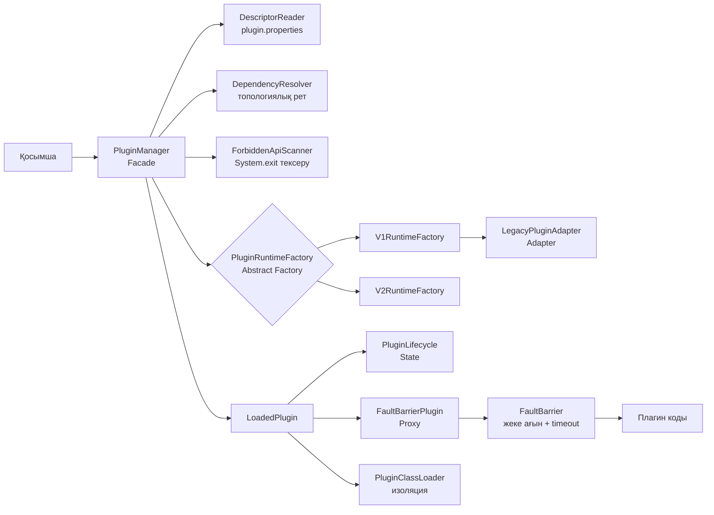

# S4 · Плагин платформасы (Plugin Platform)

Автор: Амангелді Мадияр · ВТиПО, 4 курс · Java 17+, Maven

## Қысқаша: бұл не және қалай іске қосады

Негізгі қосымшаны өзгертпей JAR-плагиндерді жүктейтін, изоляциялайтын, басқаратын және қайта іске қоспай жаңартатын платформа.

1. JDK 17+ және Maven 3.9+ орнатылғанын тексеріңіз: `java -version`, `mvn -v`
2. Репозиторийді клондаңыз: `git clone <repo-url>` және `cd s4-plugin-platform`
3. Build + барлық тесттер + coverage тексерісі: `mvn verify`
4. Mutation testing: `mvn org.pitest:pitest-maven:mutationCoverage`
5. Есептер: `target/site/jacoco/index.html` (coverage), `target/pit-reports/index.html` (mutation)

   ### Демо (қорғауға арналған)

Негізгі сценарий қадамдап: орнату → іске қосу → v1 плагині адаптер арқылы → зиянды плагиннің шабуылдары → System.exit бар плагин қабылданбайды → hot reload → тоқтату.

```bash
mvn test-compile
java -cp "target/classes;target/test-classes" kz.madiyar.plugins.demo.PlatformDemo
```

## Архитектура



Қабаттар (пакеттер):

| Пакет | Мазмұны | Кім көреді |
|-------|---------|-----------|
| `kz.madiyar.plugins.api` | `Plugin` (v2), `PluginContext` | хост және плагиндер |
| `kz.madiyar.plugins.api.v1` | `LegacyPlugin` (v1) | хост және ескі плагиндер |
| `kz.madiyar.plugins.host..` | менеджер, жүктеу, өмірлік цикл, fault barrier | тек хост (ArchUnit + ClassLoader қорғайды) |

Плагин JAR-ының түбірінде `plugin.properties`:

```properties
id=hello
version=1.0.0
api=2
main=kz.madiyar.plugins.samples.HelloPlugin
dependencies=core,logging
```

Үлгі плагиндер (`src/test/java/.../samples`): `HelloPlugin` (v2), `LegacyUpperPlugin` (v1), `EvilPlugin` (шексіз цикл, исключение, OOM, StackOverflow) және `ExitPlugin` (`System.exit`, `Runtime.halt`).

## Талаптар статусы

| Талап | Шешім | Дәлел (тест) |
|-------|-------|--------------|
| R1 дескриптор, топологиялық рет, цикл қатесі | `DescriptorReader`, `DependencyResolver` | `DependencyResolverTest`, `DescriptorReaderTest`, `PluginManagerTest.cycleIsRejectedAndNothingIsInstalled` |
| R2 жеке ClassLoader, тек API көрінеді | `PluginClassLoader` + ArchUnit | `PluginClassLoaderTest`, `ArchitectureTest` |
| R3 өмірлік цикл State | `PluginState`, `PluginLifecycle` | `PluginStateTest` |
| R4 v1 плагині Adapter арқылы | `LegacyPluginAdapter`, `V1RuntimeFactory` | `RuntimeFactoryTest`, `PluginManagerTest.startAllActivatesEverythingAndV1PluginWorksThroughAdapter` |
| R5 fault barrier (Proxy) | `FaultBarrierPlugin`, `FaultBarrier`, `ForbiddenApiScanner` | `FaultBarrierTest`, `MaliciousPluginTest`, `ForbiddenApiScannerTest` |
| R6 hot reload, жад ағуы жоқ | `PluginManager.reload` | `PluginManagerTest.reload*`, `HotReloadMemoryTest` |

## Қабылдау шарттарының статусы

| Шарт | Нәтиже | Дәлел (тест аты / өлшем файлы) |
|------|--------|-------------------------------|
| Зиянды плагин хостты тоқтата алмайды | ✅ | `MaliciousPluginTest` (boom, oom, deep, loop), `PluginManagerTest.pluginCallingSystemExitIsRejectedBeforeAnyCodeRuns` |
| Hot reload-тан кейін ескі ClassLoader GC-мен жиналады | ✅ | `HotReloadMemoryTest` |
| Line coverage ≥ 80% | ✅ 96,8% (464 жолдың 449-ы), branch 96% | `target/site/jacoco/index.html`; CI-да `jacoco:check` қақпасы |
| Mutation score ≥ 60% | ✅ 90% (153 мутация, 138 өлтірілді) | `target/pit-reports/index.html` |

Тест тегтері: `chaos` (циклге түскен ағын қалдырады) және `gc` (`System.gc` уақытына тәуелді) — `mvn verify`-да жүреді, тек mutation testing-тен шығарылған.

## Үлгілер

[docs/PATTERN_REGISTER.md](docs/PATTERN_REGISTER.md) · ADR-лер: [docs/adr](docs/adr/)

## Белгілі шектеулер және ашық сұрақтар

- Java-да ағынды өлтіру мүмкін емес: шексіз циклге түскен плагин карантинге түседі, бірақ оның daemon ағыны JVM жабылғанша CPU қолданады және кластары жадта қалады (ADR-0003).
- `System.exit` статикалық тексеріледі; рефлексия арқылы шақыру ұсталмайды (ADR-0003).
- Бір JVM ішінде плагиннің жадын шектеу мүмкін емес. Толық шешім — әр плагин бөлек процесте.
- Плагиндер бір-бірінің кластарын көрмейді; тәуелділік тек жүктеу/іске қосу ретіне әсер етеді (ADR-0001).
- Reload кезінде қысқа уақыт екі нұсқа қатар белсенді (ADR-0005).

## AI қолдану

Claude (Anthropic) көмегімен: жоба құрылымы, `pom.xml`/CI баптаулары, кодтың бір бөлігі және тесттер жазылды, ADR жобалары дайындалды. Әр бөлік түсіндірілді, мен оны оқып, өз машинамда іске қостым; тест нәтижелері өз машинамда алынды. Әр PR сипаттамасында AI қолдануы көрсетілген.
